# How Nova works — diagrams

A visual tour of the kernel, from the loader's jump to the userland
syscall loop. Each diagram is written in Mermaid, so it renders on a
forge (GitHub, GitLab, ...) and stays reviewable as text.

The diagrams describe the code in this tree; the
[ROADMAP](ROADMAP.md) has the milestone-by-milestone status.

---

## 1. The whole kernel on one page

```
        UEFI / BIOS / bhyve
                │  loads /boot/kernel/kernel
                ▼
        FreeBSD loader(8)
                │  long mode, paging on, modulep + kernend on the stack
                ▼
┌───────────────────────────────────────────────────────────────────────┐
│  Nova kernel image  (sys/conf — like FreeBSD's GENERIC)               │
│                                                                       │
│  services — 100% safe Rust, #![forbid(unsafe_code)]                   │
│  ┌──────────┬──────────┬──────────────┬──────────────┬────────────┐   │
│  │ kern     │ vm       │ exec/elf     │ compat/      │ dev/vt     │   │
│  │ init,    │ fault,   │ ELF image    │ freebsd      │ video      │   │
│  │ proc,    │ mmap     │ activator    │ (ABI)        │ console    │   │
│  │ exec,    │          │              │              │            │   │
│  │ VFS, tty │          │ fs/freebsd/  │              │            │   │
│  └────┬─────┴────┬─────┴──────┬───────┴──────┬───────┴─────┬──────┘   │
│       │          │            │              │             │          │
│       ▼          ▼            ▼              ▼             ▼          │
│  framework — trusted, may use unsafe (the only bridge to MD)          │
│  ┌─────────┬──────────────┬────────────────────┬──────────────────┐   │
│  │ cpu     │ task         │ mm                 │ sync / user /    │   │
│  │ pcpu    │ threads,     │ vm_phys, Frame,    │ cons / fb /      │   │
│  │ intr    │ scheduler    │ kmem, malloc,      │ clock / smp      │   │
│  │         │ mechanism    │ kstack             │                  │   │
│  └────┬────┴──────┬───────┴─────────┬──────────┴────────┬─────────┘   │
│       │           │                 │                   │             │
│       ▼           ▼                 ▼                   ▼             │
│  base: libkern (buddy, spinlock, chacha20, ...)                       │
│        sys     (errno, signal, elf, kenv, physmem, ...)               │
│        mdi     (traits only: the whole MD contract)                   │
│       │                                                               │
│       ▼  static dispatch through the mdi traits                       │
│  MD — trusted: arch/amd64 + arch/x86   (arch/riscv64 is check-only)   │
└───────────────────────────────────┬───────────────────────────────────┘
                                    ▼
                       CPU, APIC, COM1, framebuffer, RAM
```

The arrow between layers is a dependency arrow, never the reverse: MD
code cannot reach the framework or a service except through the upcalls
declared in `mdi` and bound by `sys/conf`.

---

## 2. Crate dependencies (what `checklayers` enforces)

Arrows point at the dependency.

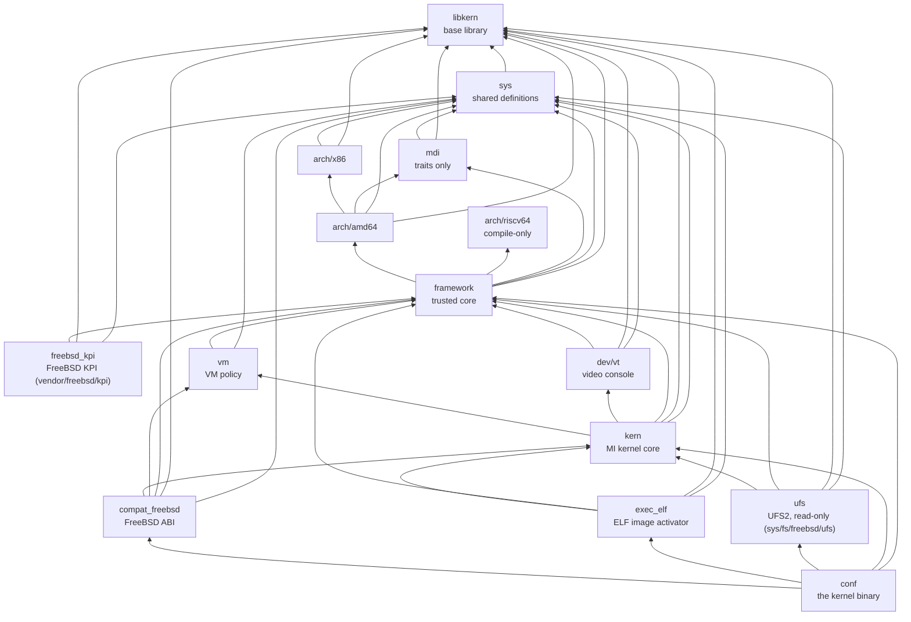

Rules of thumb:

* only `framework` names an architecture (`framework/arch/mod.rs`);
* only `conf` names an ABI (`compat/freebsd`) or a file system (`ufs`);
* services never depend on `mdi` or `arch/*` — they call `framework`;
* a driver will depend on `framework` and `freebsd_kpi` (no driver is
  built yet); `compat/*` never depends on either (R22/R23).

---

## 3. Boot: from `loader(8)` to `mi_startup`

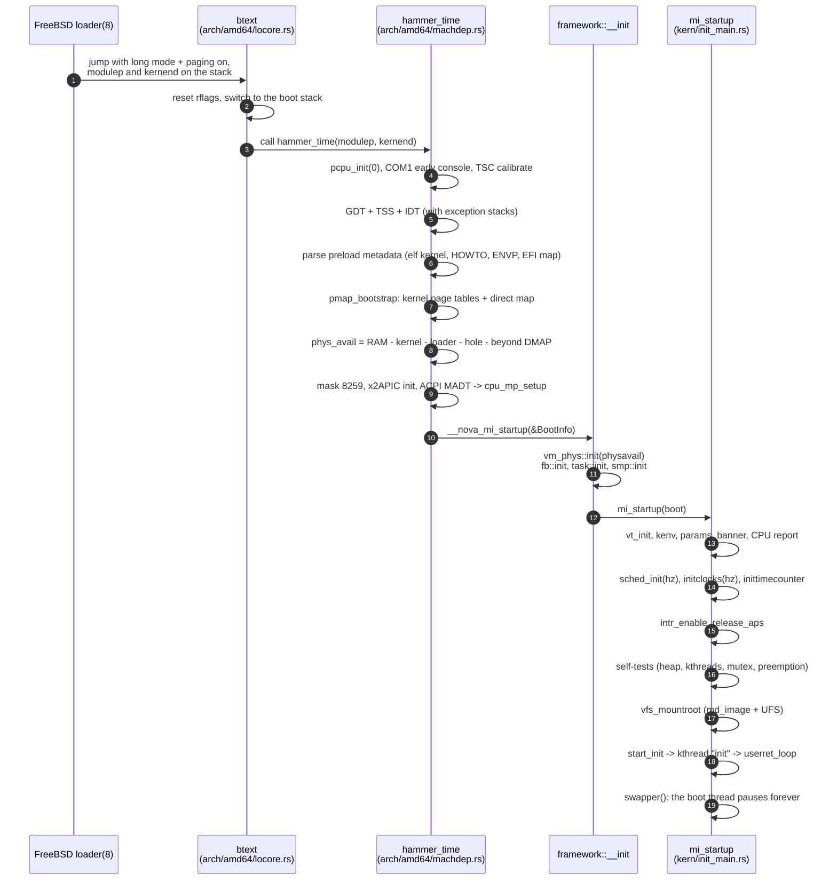

`kernel_entry!` is what makes the MD→MI jump type-safe: `conf/main.rs`
passes `kern::init_main::mi_startup`, the macro checks it against
`mdi::MiStartup`, defines `__nova_mi_startup`, and `hammer_time` calls
that symbol.

### `mi_startup` step by step

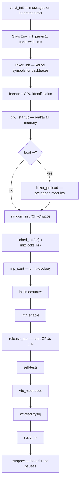

---

## 4. Runtime: who talks to whom

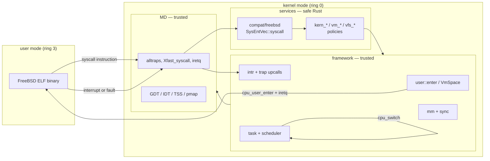

The kernel never dereferences a user pointer: services take a `VmSpace`
and copy through `copyin`/`copyout`.

---

## 5. A system call

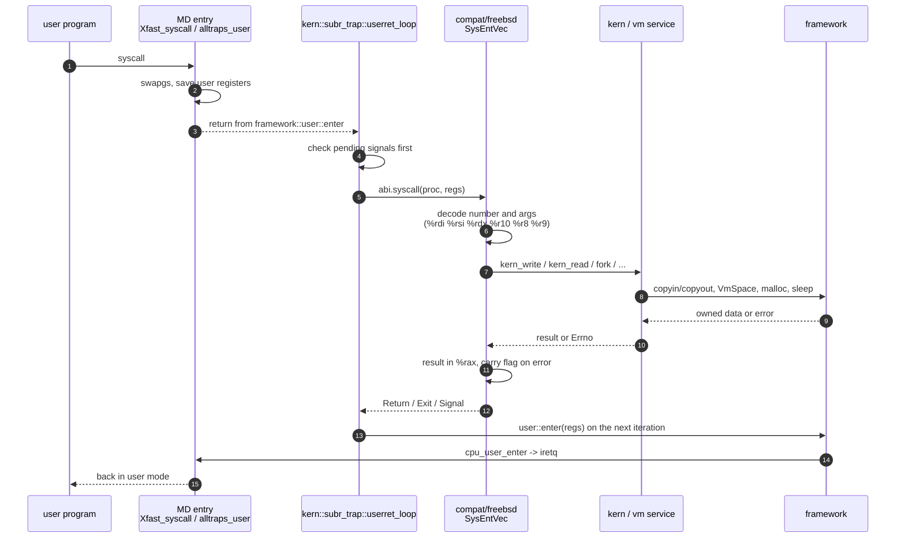

`userret_loop` is plain Rust on the thread's kernel stack: entering user
mode is a function call that returns when the program comes back to the
kernel. There is no separate "return to user" path to audit.

---

## 6. Traps, interrupts, clock and preemption

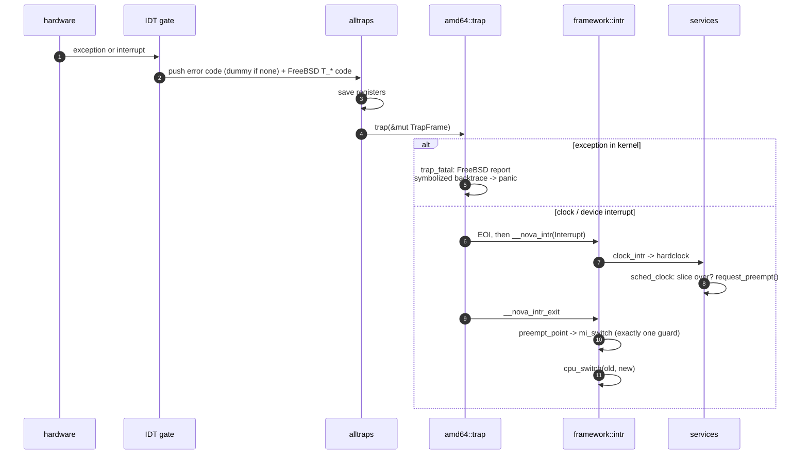

* `IPI_AST` → `request_preempt` on the target CPU.
* `IPI_STOP` → `cpu_halt` (the other CPUs stop when one panics).
* A thread can switch only with exactly one interrupt guard held; a
  kernel stack overflow hits an unmapped guard page and becomes a double
  fault on its own IST stack.

---

## 7. Threads and the pluggable scheduler

The framework owns the **mechanism**; `sched_4bsd` owns the **policy**.

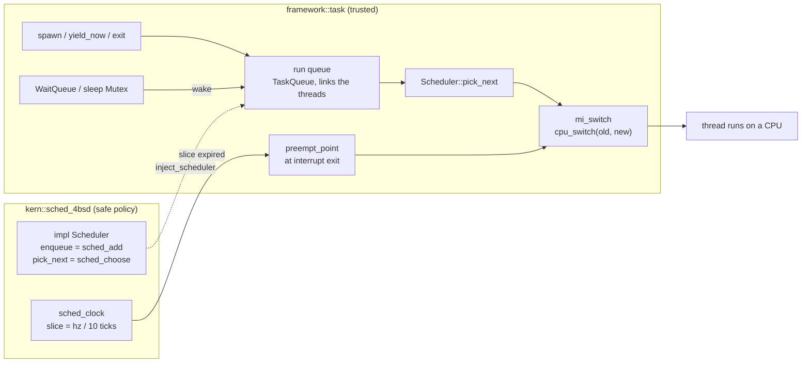

FreeBSD's names are kept on both sides: `sched_add`, `sched_choose`,
`sched_clock`, `mi_switch`, `kthread_add`, `pause`.

---

## 8. Process and userland lifecycle

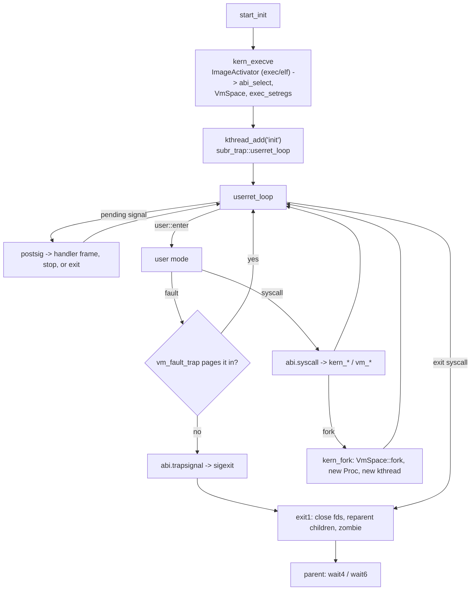

`init` is the first file of `init_path` that the loader preloaded or that
exists on the root file system. Its exit is fatal, as in FreeBSD:
`panic: Going nowhere without my init!`

---

## 9. VFS: the kernel knows no file system

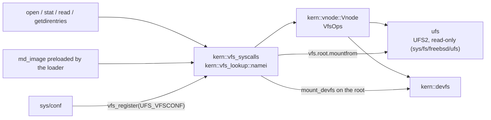

The VFS works on vnodes; the root's type is a string
(`vfs.root.mountfrom`), and `conf` is the only place that names UFS.

---

## 10. Memory

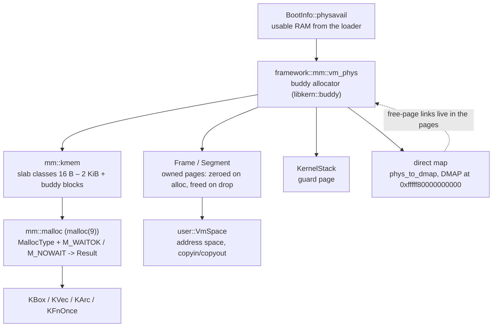

There is **no global allocator and no `alloc` crate** (rule R16): `Box`,
`Vec` and `format!` do not exist. Every allocation names its owner and
whether it may sleep, and returns an error instead of panicking. Frames
are read and written by copying, never through a `&[u8]`, so userland
can never invalidate a kernel reference.

---

## 11. Starting the application processors

```mermaid
sequenceDiagram
    autonumber
    participant B as BSP (CPU 0)
    participant F as framework::smp
    participant M as amd64 mp_machdep
    participant A as AP

    B->>B: cpu_mp_setup reads ACPI MADT (XSDT -> MADT)
    B->>F: start_ap(n)
    F->>F: allocate idle thread, boot stack, 3 exception stacks
    F->>M: cpu_start_ap(n, stack_top, exception stacks)
    M->>M: copy mpboot to 0x8000, INIT-SIPI-SIPI
    M->>A: real -> protected -> long mode
    A->>A: init_secondary: kernel CR3, %gs, GDT/TSS/IST, x2APIC
    A->>F: __nova_ap_startup(n)
    F->>F: clock, mp_ncpus_inc, online, ap_enter(idle)
    Note over A: idle thread sleeps in hlt;<br/>IPI_AST wakes it to reschedule
```

Only the boot CPU's clock advances `ticks`; the local APIC timer is
calibrated once and reused by the APs.

---

## 12. Build and verification

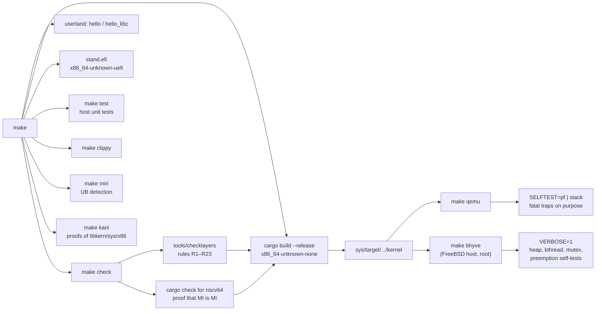

The kernel that violates the layering is never built: `make check` runs
before `cargo build`.

---

## 13. Where the diagrams stop

The tree already contains the boot path (milestone 0–3b), user address
spaces and user mode (milestone 4), and the userland-facing work of
milestone 5: FPU/SSE per thread, demand paging, `mmap`, signals with
handlers and `sigreturn`, TLS, sysctl, the console line discipline and
`TIOCSPGRP`, descriptors, VFS with read-only UFS2 and devfs, processes,
`fork`/`execve`/`wait`, and pipes. That is why the diagrams show `init`
running and the syscall loop, not a kernel that halts before userland.

The diagrams deliberately do not show what is still on the roadmap:

* the full `mmap` surface, the sysctls `ld-elf.so.1` reads, and dynamic
  binaries — milestone 6;
* `bus_space`/`bus_dma`, PCI, virtio-blk — milestone 7;
* loadable modules — milestone 7b;
* the network stack — milestone 8;
* TLB shootdown IPIs, NMI stop, per-CPU run queues (`sched_ule`), xAPIC;
* real hardware (today: bhyve/QEMU, and x2APIC only).

Each of them enters the picture at an already-drawn boundary: a driver
becomes another safe service calling `framework`; a scheduler replaces
`Sched4bsd`; an ABI becomes another `compat/<abi>` registered by `conf`.

The boundaries the diagrams do draw are enforced, not just documented:

* **Executable format:** the core knows `ImageFile` and
  `kern_exec::ImageActivator`; `sys/exec/elf` is a service, registered by
  `conf`, and rule R20 keeps `Ehdr`/`PT_LOAD` out of `kern`. A new format
  is a new crate under `sys/exec/`, with no core change.
* **ABI:** `SysEntVec` is split into `ExecAbi`, `SyscallAbi` and the
  optional `SignalAbi`; a personality with no signal model returns `None`
  from `signals()`. The POSIX signal mechanism is still `kern_sig` in the
  kernel core: moving it into a personality needs a generic `ProcEvent`
  layer (the remaining signal-isolation step).
* **First process:** `InitPolicy` (default `init_path`, the `-s` of
  single-user mode) is registered by `conf`; `kern` no longer spells
  FreeBSD's userland out.
* **File system:** UFS is `sys/fs/freebsd/ufs`, not under
  `compat/freebsd`; rule R19 keeps file system names out of the core,
  and a file system is not an ABI.
