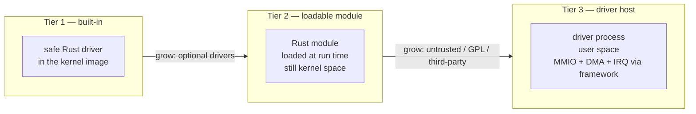

# Drivers in Nova — proposal

Status: **proposal, partly implemented.** The directory conventions and
rules R21–R23 exist; `sys/vendor/freebsd/kpi` is a real crate today
(`malloc(9)`, `mtx(9)`), and `sys/dev/freebsd/` is ready for the first
port. The device layer (`framework::bus`) and the first driver are the
next steps.

This document describes how Nova can host drivers from FreeBSD, Linux
and native Rust without making the kernel core depend on any of them.

## 1. Three axes, not one

A driver port touches three independent things. `compat/freebsd/dev/`
would put all three in the same directory, and that causes the same
coupling we just removed from UFS: a driver is not an ABI.

| Axis | What it is | Where it lives |
|---|---|---|
| **Userland ABI** | syscall numbers, struct layouts, `errno`, signals, start-up stack | `sys/compat/<abi>/` |
| **Kernel KPI** | the kernel programming interface a driver source uses: `bus_space`, `bus_dma`, newbus, `mtx`, `callout`, `malloc`, `ifnet`, `bio`, ... | `sys/vendor/<origin>/kpi/` |
| **Driver** | the code for one piece of hardware (`e1000`, `ahci`, `virtio-blk`, ...) | `sys/dev/...` (native) or `sys/dev/<origin>/...` (ported) |

Consequences:

* FreeBSD drivers do **not** need the FreeBSD userland personality. An
  `e1000` driver is the same hardware whether the userland is FreeBSD,
  Linux or native Nova.
* A Linux driver and a FreeBSD driver for the same chip remain two
  ports, not two ABIs. The driver's origin is metadata (diagnostics,
  licence, which KPI it uses), not a kernel dependency.
* `compat/freebsd` stays what it is today: the FreeBSD **userland ABI**
  (`sysentvec`, syscalls, signals, exec stack). It never gains a `dev/`.

## 2. Proposed tree

```
sys/
├── framework/              trusted mechanisms
│   └── bus/                bus_space, bus_dma, IRQ, MMIO, PCI, IOMMU
├── dev/                    drivers — safe Rust, framework only
│   ├── vt/                 native: video console
│   ├── virtio/             native
│   ├── storage/            native: ahci, nvme
│   ├── net/                native
│   └── freebsd/            source-ported FreeBSD drivers
│       ├── e1000/
│       └── ahci/
├── vendor/                 imported code and its KPI, grouped by origin
│   ├── freebsd/
│   │   ├── kpi/            freebsd_kpi: malloc(9), mtx(9), bus_space,
│   │   │                   bus_dma, callout, newbus, ifnet, bio...
│   │   └── LICENSE
│   └── linux/
│       ├── kpi/            linuxkpi (Linux kernel interfaces)
│       └── LICENSE
└── compat/                 userland ABI personalities only
    ├── freebsd/            sysentvec, syscalls, signals, exec
    └── linux/
```

`sys/vendor/*` and `sys/dev/<origin>/*` are the R15 exception (origin
names are expected there). The rules that keep it honest:

* only `conf` and drivers depend on `sys/vendor/*/kpi`;
* `sys/compat/*` (userland ABI) never depends on `sys/vendor/*` or on a
  driver (R22);
* a driver never names a userland ABI, and depends only on the base,
  `framework` and its KPI (R23);
* `conf` is the only place that registers drivers (built-in) and KPI
  modules.

If you prefer the word `import/` or `port/` instead of `vendor/`, it is
the same design. The important part is that it is **not** under
`compat/`.

## 3. Three runtime tiers

"Not in the kernel" can mean two different things. Both are useful, at
different costs.



| Tier | Isolation | Performance | Complexity | Use for |
|---|---|---|---|---|
| **1. Built-in** | ABI + memory safety; a bug panics, cannot corrupt memory | best | lowest | boot console, timer, PCI host, virtio, storage, network |
| **2. Loadable module** | same as tier 1, but not in the base image | best | medium | optional hardware, vendor add-ons |
| **3. Driver host** | full process isolation; a bug cannot panic the kernel | IPC + IOMMU overhead | high | untrusted drivers, GPL drivers, USB/DRM, third-party |

The framework should expose the **same** driver-facing API in all three
tiers. A driver written against `MmioRegion`/`DmaBuffer`/`Irq` can run
in the kernel today and behind a userspace host later, exactly as the
architecture document already promises.

### What "load FreeBSD drivers" can mean

| Approach | Verdict |
|---|---|
| Load an unmodified FreeBSD `.ko` binary | **Not now.** A `.ko` is built against FreeBSD's *kernel* KBI: symbol table, struct layouts, `sysinit`, `MODULE_DEPEND`, `bus_space_tag_t`, `if_t`, `bio`, ... Nova only implements the FreeBSD **syscall** ABI. Binary KBI compatibility is a separate, version-locked, unsafe project. |
| Port the C source against a FreeBSD KPI shim | **Possible, but heavy.** Needs a C compiler, an `unsafe` exception and a stable struct layout; it breaks the "100% Rust, safe services" model unless the driver is isolated (tier 3). |
| Port the driver to safe Rust against `framework` | **Recommended for tier 1.** More work per driver, but the framekernel invariant holds. |
| Run the original driver in a userspace host | **Best for Linux/GPL and third-party code.** Needs IOMMU, user interrupts and IPC. |

The pragmatic order is: native Rust for the drivers Nova needs to boot,
then a FreeBSD KPI for source ports, then a userspace host for the rest.
LinuxKPI is a later, larger project (it is large in FreeBSD too); it
should start with simple PCI drivers, not DRM.

## 4. One driver interface

The mechanism that makes all three tiers possible is a small,
capability-based interface. Drivers never see a raw pointer.

```rust
/// One piece of hardware, as the bus found it.
pub struct Device { /* bus, address, resources */ }

impl Device {
    pub fn mmio(&self, bar: u8) -> Result<MmioRegion, Error>;
    pub fn pio(&self, bar: u8) -> Result<PioRegion, Error>;
    pub fn irq(&self, n: u8) -> Result<Irq, Error>;
    pub fn dma(&self) -> Result<DmaDomain, Error>;
    pub fn config(&self) -> &PciConfig;
}

/// What a driver offers to the bus.
pub trait Driver: Sync {
    fn name(&self) -> &'static str;
    fn probe(&self, dev: &Device) -> Probe;
    fn attach(&self, dev: Device) -> Result<(), Error>;
    fn detach(&self, dev: Device);
}
```

`MmioRegion`, `PioRegion`, `DmaBuffer`, `Irq` and `DmaDomain` are the
framework's safe wrappers:

* `MmioRegion` bounds every read/write to the BAR, names the width and
  the barrier semantics (FreeBSD's `bus_space`);
* `DmaBuffer` owns its pages, gives the device a physical address and
  the CPU a safe slice, and handles cache maintenance (FreeBSD's
  `bus_dma`);
* `Irq` is a handle to an allocated interrupt, not a vector number;
* `DmaDomain` is the IOMMU context (identity today, isolated later).

A driver is registered as:

```rust
pub struct DriverDesc {
    pub name: &'static str,
    /// `Native`, `Freebsd`, `Linux`; for diagnostics and licensing.
    pub origin: Origin,
    pub driver: &'static dyn Driver,
}
```

`sys/conf` registers built-ins; the module loader registers modules at
load time. The bus runs `probe`/`attach` in order.

## 5. Framework prerequisites

A KPI shim is useless before the mechanisms under it exist. In order:

1. **`framework::bus`** (milestone 7):
   * `bus_space` (MMIO/PIO, width, endianness, barriers);
   * `bus_dma` (coherent and streaming, segments, bounce buffers);
   * IRQ allocation and dispatch (legacy, MSI, MSI-X);
   * `DmaDomain` (identity first, IOMMU later).
2. **PCI**: ECAM first, legacy config space second; BAR discovery,
   bus/master enable, capability walking.
3. **ACPI**: the MADT is already parsed; add the namespace, `_PRT`
   (interrupt routing), `_CRS`, power resources.
4. **Device/driver tree**: `Device`, `Driver`, probe/attach/detach,
   resource allocation, a small newbus-like registry.
5. **Time and deferral**: `callout` and taskqueues over the existing
   clock/threads.
6. **Module loader** (milestone 7b): Rust modules with a stable
   `extern "C"` vtable, not a Rust ABI.
7. **Driver host** (later): IOMMU, interrupt delivery to user mode,
   shared rings, zero-copy buffers.

Only then does a FreeBSD KPI or LinuxKPI become meaningful. Otherwise
the shim is a thin veneer over nothing.

## 6. Licensing is an architectural constraint

* FreeBSD drivers are mostly **BSD-2-Clause/BSD-3-Clause**: compatible
  with MPL-2.0; keep the notice and the original copyright.
* Linux drivers are **GPL-2.0**: linking them into an MPL-2.0 kernel is
  a licensing problem, not just a technical one. The clean boundary is
  a **userspace driver host** (separate process, separate licence), or
  a GPL-compatible module if you ever choose that.
* Each `sys/vendor/<origin>/` should carry its own `LICENSE` and a
  `README` naming the upstream version and the files changed. The
  existing third-party header rule (R8, `THIRD_PARTY_LICENSES`) already
  covers the source files.

This is another reason not to put imported drivers under
`compat/freebsd`: `compat/freebsd` is MPL-2.0 Nova code, while
`vendor/freebsd` is imported BSD code with its own provenance.

## 7. Proposed layering rules

| Rule | Statement |
|---|---|
| **R21** | `sys/vendor/<origin>/` and `sys/dev/<origin>/` may use origin vocabulary (`freebsd`, `linux`, ...); they are the only places besides `compat/` and `conf` where it is allowed. |
| **R22** | ABI personalities (`sys/compat/*`) never depend on `sys/vendor/*`, on a driver or on a file system. Drivers never depend on `sys/compat/*`. |
| **R23** | Drivers (`sys/dev/*`) depend only on the base layer, `framework` and their origin's KPI. A driver that needs a kernel service asks the framework, not another service. |
| **R24** | A driver never uses `unsafe`; it reaches hardware through `MmioRegion`, `PioRegion`, `DmaBuffer` and `Irq`. A C driver is an explicit exception, lives in `sys/vendor/<origin>/drivers/`, and is treated as untrusted until it runs in a driver host. |
| **R25** | `conf` is the only place that registers a driver or a KPI module. The bus discovers; `conf` decides what is built in. |

These rules are cheap to check with the existing `checklayers`
(identifiers, dependency edges, `unsafe` attributes).

## 8. Migration path

| Step | Deliverable | Why |
|---|---|---|
| 1 | `framework::bus` + `bus_space`/`bus_dma` + IRQ + PCI ECAM | the foundation every driver needs |
| 2 | Native `virtio-blk` in `sys/dev/virtio` | first real driver, proves the model, boots from a disk |
| 3 | `Driver`/`Device` registry, built-ins in `conf` | one interface for native and imported drivers |
| 4 | Native `e1000`/`igb` or `ahci` | a second, PCI-heavy driver |
| 5 | Rust loadable modules (milestone 7b) | optional drivers without rebuilding the kernel |
| 6 | `sys/vendor/freebsd/kpi` + one driver in `sys/dev/freebsd/` | proves source-level FreeBSD reuse |
| 7 | Driver host: IOMMU, user IRQ, shared rings | untrusted/third-party/GPL drivers |
| 8 | `sys/vendor/linux/kpi` + a simple driver | Linux reuse; DRM last, not first |

## 9. Recommendation

1. **Do not use `compat/freebsd/dev/`.** Keep `compat/` for the
   userland ABI. Put ported drivers under `sys/dev/<origin>/` and their
   KPI under `sys/vendor/<origin>/kpi/`.
2. **Do not promise binary `.ko` compatibility.** FreeBSD `.ko` loading
   needs FreeBSD's kernel KBI, not its syscall ABI; it is a separate
   project and it is unsafe by nature.
3. **Start with native Rust drivers** (`virtio`, then a simple PCI
   device) to build the framework mechanisms. A KPI before
   `bus_space`/`bus_dma` is premature.
4. **Design the driver API for both kernel and userspace from day one**
   (`MmioRegion`, `DmaBuffer`, `Irq`, `Device`). That is what makes the
   kernel "extremely flexible" without giving up the framekernel
   invariant.
5. **Keep the origin as metadata.** `Origin::Freebsd` in
   `DriverDesc` is useful for diagnostics and licensing; it must not
   change which ABI the userland uses or which crate the kernel core
   depends on.
